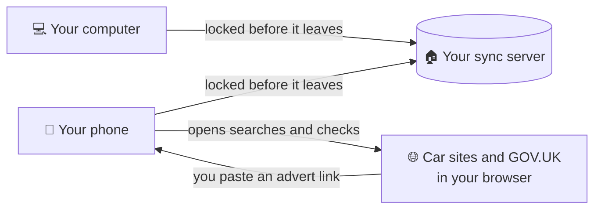

<h1 align="center">
  <br>
  <a href="https://github.com/sudharamachandranrajeev/vahana-anveshana"></a>
  <br>
  Vahana Anveshana
  <br>
</h1>

<h4 align="center">Find the right car, pay the right price, and keep on top of MOT, tax and running costs until you sell.</h4>

<p align="center">
  <a href="https://github.com/sudharamachandranrajeev/vahana-anveshana/releases"></a>
  
  
  <a href="https://github.com/sudharamachandranrajeev/brahma"></a>
</p>

<p align="center">
  <a href="#-what-it-does">What it does</a> •
  <a href="#-get-started">Get started</a> •
  <a href="#-how-it-works">How it works</a> •
  <a href="#-faq-and-troubleshooting">FAQ</a> •
  <a href="#%EF%B8%8F-for-developers">For developers</a>
</p>

<p align="center">
  
</p>

Vahana Anveshana is for anyone in the UK buying, running or selling a car. It gathers the
search sites, the price checks, the finance sums and the dates you must not miss in one place,
on your own devices. Status: **early test releases**. Figures are a starting point for your own
checks, not advice.

## ✨ What it does

- 🔎 **Search every site at once** – enter make, model, budget and postcode once. The app builds
  the search on AutoTrader, Gumtree, eBay, PistonHeads, DoneDeal and more, and opens it in your
  browser.
- 🚗 **Your garage** – keep every car you are looking at, from an advert link or typed in, and
  move it on as you go.
- 🚩 **Spot a bad deal** – see the price against similar cars you saved, red flags such as too
  cheap or odd mileage, and the asking-price history.
- 💷 **Pay the least** – cash, loan, hire purchase (HP), PCP and lease, compared by what they
  really cost you each month.
- 📅 **Never miss a date** – MOT, tax, insurance and service counting down, with calendar
  reminders.
- 📒 **Running costs** – a logbook for fuel and bills, real miles per gallon and cost a mile, and
  a PCP mileage check.
- 🤝 **Sell safely** – offers side by side, a safe-selling list, the DVLA steps and the true cost
  of owning the car.
- 📖 **Know your rights** – a plain guide to buyer rights, tax and the checks before you pay.
- 🔒 **Private by default** – data is encrypted on the device. Sync is optional, and one account
  works in every Brahma app.

<details>
<summary>Full list of what each car's page covers</summary>

| Stage | What is included |
| --- | --- |
| Buying | Price against similar saved cars, red flags (too cheap, odd mileage, used electric car), asking-price history, free GOV.UK checks (MOT history, tax, recalls), checklists for before paying and collection day |
| Owning | MOT, tax, insurance and service dates (first MOT at 3 years, 4 in Northern Ireland), calendar reminders, logbook, PCP mileage pace, dealer-rights dates |
| Selling | Offers side by side, a safe-selling list, the DVLA steps, a service history to paste into an advert, the true cost of owning once sold |
| Search sites | AutoTrader, Gumtree, Facebook Marketplace, eBay, UsedCarsNI, DoneDeal, PistonHeads, online stores, dealer groups, new-car deal sites, plus your own. Northern Ireland sites come first for BT postcodes |

</details>

## 📸 Screenshots

<table>
  <tr>
    <td align="center"><br><sub>Search</sub></td>
    <td align="center"><br><sub>Garage</sub></td>
    <td align="center"><br><sub>Finance (dark)</sub></td>
  </tr>
  <tr>
    <td align="center"><br><sub>A car you own</sub></td>
    <td align="center"><br><sub>Garage (dark)</sub></td>
    <td align="center"><br><sub>Finance</sub></td>
  </tr>
</table>

<p align="center">
  <br>
  <sub>Finance on a desktop window</sub>
</p>

<sub>All screenshots show made-up cars, rendered from the app's code.</sub>

## 🚀 Get started

### Step 1 – Download

Open the [releases page](https://github.com/sudharamachandranrajeev/vahana-anveshana/releases)
and, under the newest release, pick the file for your device:

| Your device | File to download | Works on |
| --- | --- | --- |
| 🐧 Linux computer | `Vahana-<version>-linux-x64.tar.gz` | Ubuntu 24.04, Fedora, Arch and similar (Intel/AMD 64-bit) |
| 🪟 Windows computer | `Vahana-<version>-windows-x64-setup.exe` | Windows 10 and 11 |
| 🤖 Android phone | `Vahana-<version>-android.apk` | Android 7 and newer |

Each release also has `SHA256SUMS.txt`, a list of fingerprints to check the files are genuine.

### Step 2 – Install

<details>
<summary><b>🐧 Linux</b></summary>

1. Open a terminal in the folder where the download landed.
2. Unpack it and run the installer as your normal user (not `sudo`):
   ```sh
   tar -xzf Vahana-*-linux-x64.tar.gz
   cd vahana-*-linux-x64 && ./install.sh
   ```
3. Open **Vahana Anveshana** from your app menu.

It installs for your user only. It needs GTK 3, libsecret and the desktop keyring (the app that
stores passwords) running. To remove it later: `./install.sh --uninstall`. Your data stays.

</details>

<details>
<summary><b>🪟 Windows</b></summary>

1. Double-click `Vahana-<version>-windows-x64-setup.exe`. No admin rights needed.
2. Windows may say *"Windows protected your PC"*. This appears because the app isn't paid-signed
   yet, not because it is harmful. Click **More info → Run anyway**.
3. Follow the installer, then open **Vahana Anveshana** from the Start menu.

Prefer no installer? Download `…-windows-x64-portable.zip`, unzip it anywhere and run
`vahana.exe`.

</details>

<details>
<summary><b>🤖 Android</b></summary>

1. Open the downloaded `.apk` on your phone.
2. If Android asks, allow installs from your browser or file manager. This is normal for apps
   from outside the Play Store.
3. Tap **Install**, then **Open**.

Newer versions install over the top and keep your data.

</details>

### Step 3 – First launch

The app opens on **Search**. Every screen works empty, so there is nothing to set up first.

1. **Say what you want**: under **What you want**, pick **Used** or **New**, then fill in
   **Make**, **Model**, **Most you will pay** and **Your postcode**. Tap **Remember this**.
2. **Open a site**: tap any search site. It opens in your browser with your choices filled in.
3. **Save a car you like**: on **Garage**, tap **Add → From an advert link** and paste the link.
   Or choose **Type it in**.
4. **Compare the money**: on **Garage**, tap **Finance** under the car. Cash, loan, HP, PCP and
   lease appear side by side.

> [!NOTE]
> The next release opens with a short welcome. It asks where your data should live: on this
> device only, or synced through a home or cloud server. It also adds an app lock (PIN or
> fingerprint), a tip at the top of each screen, **Ask AI** for help finding your way, and
> **Report a problem**.

### Step 4 (optional) – Use it on more than one device

Turn on sync in **Settings → Sync**. You need a sync server you own; the
[Brahma sync server guide](https://github.com/sudharamachandranrajeev/brahma/tree/main/server)
walks you through it. **Write down the recovery key** it shows and keep it safe.

## 🧭 How it works



- **On each device**, the app keeps your data in an encrypted database. Without your key it is
  unreadable.
- **Searches and GOV.UK checks open in your browser.** The app only reads an advert when you
  paste its link.
- **Sync is optional.** With it, each device locks its changes before sending them. The server
  cannot read them.
- **Nothing else leaves the device** unless you sign in to sync.

> [!IMPORTANT]
> Your password and recovery key are the only ways to unlock synced data. If you lose both, nobody
> can recover it. On Android, uninstalling the app deletes its data, so sync first.

## ❓ FAQ and troubleshooting

<details>
<summary><b>Do I need an account or the internet?</b></summary>

No account. The garage, dates, logbook and finance sums work offline. Search sites and reading an
advert link need the internet.
</details>

<details>
<summary><b>Windows says the app might be unsafe</b></summary>

The build isn't code-signed (a paid certificate). Click **More info → Run anyway**. Check the file
against `SHA256SUMS.txt` on the release if you want to be sure it is genuine.
</details>

<details>
<summary><b>Linux: the app stops at start and talks about a missing key</b></summary>

The key that unlocks your data lives in the desktop keyring. Make sure your keyring app is
running and unlocked, then start the app again.
</details>

<details>
<summary><b>An advert link brings in nothing</b></summary>

Some sites block apps from reading their pages. Choose **Add → Type it in** and copy the price
and mileage across.
</details>

<details>
<summary><b>Where is my data stored?</b></summary>

Linux: `~/.local/share/dev.brahma.vahana`. Windows: in your user's AppData folder. Android:
inside the app. Uninstalling on Linux or Windows leaves it in place.
</details>

<details>
<summary><b>I saved cars in Anveshana 0.2.0. Where are they?</b></summary>

Cars moved from Anveshana (now Graha Anveshana) to this app. They are not copied over by
themselves: add them again from their advert links, or turn on sync.
</details>

## 🛠️ For developers

<details>
<summary>Build from source, test and release</summary>

You need [Git](https://git-scm.com) and [Flutter](https://flutter.dev) 3.47.

```bash
git clone https://github.com/sudharamachandranrajeev/vahana-anveshana
cd vahana-anveshana
flutter pub get
flutter run -d linux        # or windows, or an Android device

flutter analyze && flutter test                                    # check and test
dart run build_runner build                                        # regenerate the database code
VAHANA_SHOTS=/tmp/shots flutter test test/screenshots_test.dart    # render the screenshots
scripts/make-icons.sh                                              # app icons from branding/
```

- `brahma_core` comes from the [brahma](https://github.com/sudharamachandranrajeev/brahma) repo.
  To work on both at once, add a `pubspec_overrides.yaml` (ignored by git) with
  `dependency_overrides: brahma_core: path: ../brahma/core`.
- CI runs analyse and test on each push. A `v*` tag builds, smoke-tests and publishes the
  Android, Windows and Linux builds (`.github/workflows/release.yml`).
- Changes per version: [CHANGELOG.md](CHANGELOG.md).

</details>

<details>
<summary>Credits</summary>

- [Flutter](https://flutter.dev) and [Riverpod](https://riverpod.dev)
- [drift](https://drift.simonbinder.eu) over SQLite3MultipleCiphers (through brahma_core) for the
  encrypted database
- [http](https://pub.dev/packages/http), [intl](https://pub.dev/packages/intl),
  [url_launcher](https://pub.dev/packages/url_launcher)
- [Inter](https://rsms.me/inter/) font (SIL Open Font License)
- Free GOV.UK services: [MOT history](https://www.check-mot.service.gov.uk),
  [vehicle enquiry](https://vehicleenquiry.service.gov.uk),
  [recalls](https://www.check-vehicle-recalls.service.gov.uk)

</details>

## Related

Vahana Anveshana is one app in the **Brahma** family. They share one sign-in and one sync server.

| App | What it does |
| --- | --- |
| [brahma](https://github.com/sudharamachandranrajeev/brahma) | The shared core and the all-in-one app |
| [artha](https://github.com/sudharamachandranrajeev/artha) | Money: accounts, spending, bills and investments |
| [graha-anveshana](https://github.com/sudharamachandranrajeev/graha-anveshana) | Find a home to rent or buy |
| [udyoga](https://github.com/sudharamachandranrajeev/udyoga) | Career and job hunting |
| [vidya](https://github.com/sudharamachandranrajeev/vidya) | Learning, flashcards and focus |

## License

No licence has been chosen yet; all rights reserved. Inter is under the SIL Open Font License.

---

> GitHub [@sudharamachandranrajeev](https://github.com/sudharamachandranrajeev)
